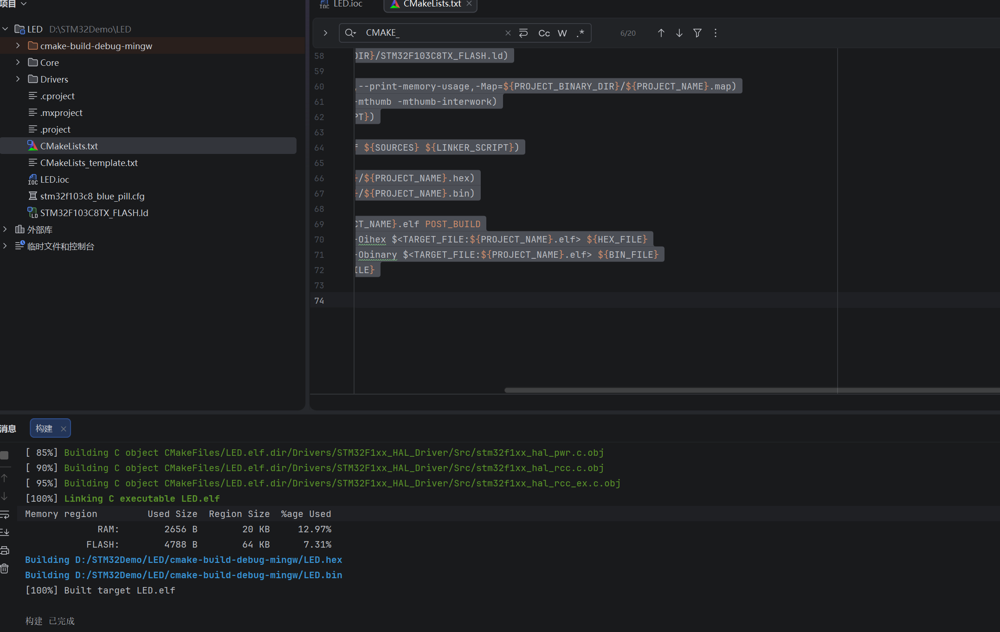

# 电控组首次培训作业

- **姓名：范钰涵**
- ***学号：20263001213***

## 一、环境与工程信息

| 项目        | 内容                                                                                  |
| --------- | ----------------------------------------------------------------------------------- |
| MCU       | STM32F103C8T6（最小系统板）                                                                |
| 工程创建工具    | STM32CubeMX 6.15.0                                                                  |
| 编译工具      | CMake + MinGW Makefiles + arm-none-eabi-gcc（GNU Arm Embedded Toolchain）             |
| 下载 / 仿真工具 | OpenOCD 0.12.0                                                                      |
| IDE       | CLion 2026.2                                                                        |
| 工程名称      | LED                                                                                 |
| 工具链宏配置    | C：arm-none-eabi-gcc，C++：arm-none-eabi-g++，ASM：arm-none-eabi-gcc，AR：arm-none-eabi-ar |

## 二、完成内容

1. 按照《南海鲨开发环境配置文档》完成环境搭建：划分 D 盘 → CLion 安装于 D:\CLion → CubeMX 安装于 D:\CubeMX → arm / STM32_CFG 复制进 CLion 目录 → OpenOCD 解压至 D 盘 → 完成用户环境变量配置。
2. 使用 STM32CubeMX 新建 STM32F103C8T6 工程：
   - RCC：HSE / LSE 均选择 Crystal/Ceramic Resonator
   - SYS：Debug 选择 Serial Wire（SWD）
   - Clock Configuration：输入 8 MHz，系统时钟 72 MHz
   - Project Manager：Toolchain / IDE 选择 STM32CubeIDE
3. 生成代码（GENERATE CODE），并在 CLion 中导入工程、完成工具链配置。
4. 编译通过：

```
Memory region         Used Size   Region Size   %age Used
             RAM:        2656 B        20 KB       12.97%
           FLASH:        4788 B        64 KB        7.31%
[100%] Built target LED.elf
构建 已完成
```

## 三、编译结果截图



## 四、遇到的问题与解决

| 问题                                                                 | 原因                                          | 解决方法                                                               |
| ------------------------------------------------------------------ | ------------------------------------------- | ------------------------------------------------------------------ |
| CubeMX 首次安装被强制装到 AppData                                           | 安装时选择了 Install for me only，该模式不允许自选路径       | 卸载后重装，改选 Install for all users，路径指定 D:\CubeMX                      |
| 点 MCU 选择器后一直转圈、加载不出芯片列表                                            | CubeMX 首次使用需要联网下载芯片数据库与固件包                  | 换手机热点 / 网络恢复后重试                                                    |
| 弹窗提示 Missing myST information                                      | 从 st.com 下载固件包需要登录 ST 账号                    | 注册 myST 账号并完成邮箱验证后登录                                               |
| OpenOCD 解压后多套一层目录，找不到 openocd.exe                                  | 压缩包内自带一层同名文件夹                               | 进入内层文件夹 Ctrl+A 剪切，回上一层粘贴，使路径变为 OpenOCD\bin\openocd.exe             |
| CLion 找不到 CMake 工程文件，设置页显示"不适用 CMake 项目"                           | 打开的是外层目录 STM32Demo，而非工程根目录 LED              | 关闭项目，重新打开到含 .ioc 的那一层 D:\STM32Demo\LED                             |
| CMake 报错 CMAKE_C_COMPILER: arm-none-eabi-gcc is not a full path    | CubeMX 生成的 CMakeLists.txt 只写了编译器名字，未写完整路径   | 将 C / C++ / ASM 编译器改为绝对路径 D:/CLion/arm/bin/arm-none-eabi-gcc.exe 等 |
| CMake 报错 Error running link command: No such file or directory（ar） | CMAKE_AR / OBJCOPY / OBJDUMP / SIZE 同样只写了名字 | 改为 D:/CLion/arm/bin/ 下的完整路径加 .exe                                  |
| 链接脚本中找不到 READONLY                                                  | 新版本 CubeMX 已修正该字段，文档 4.2 步骤不再适用             | 跳过该步骤，继续后续配置                                                       |

## 五、仓库结构

```
.
├── Core/                        # 用户代码（main.c、Inc/、Src/、Startup/）
├── Drivers/                     # CMSIS 与 STM32F1xx HAL 库
├── LED.ioc                      # STM32CubeMX 工程配置文件
├── CMakeLists.txt               # CMake 构建脚本（已修正工具链路径）
├── stm32f103c8_blue_pill.cfg    # OpenOCD 板级配置文件
├── STM32F103C8Tx_FLASH.ld       # 链接脚本
├── screenshot/
│   └── build.png                # 编译通过截图
└── README.md                    # 本文件
```

> cmake-build-debug-mingw/ 为编译产物目录，已通过 .gitignore 忽略，不提交。
